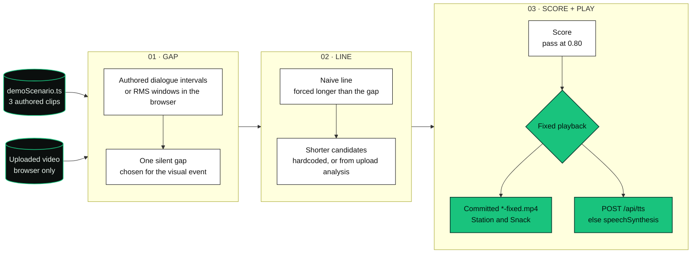
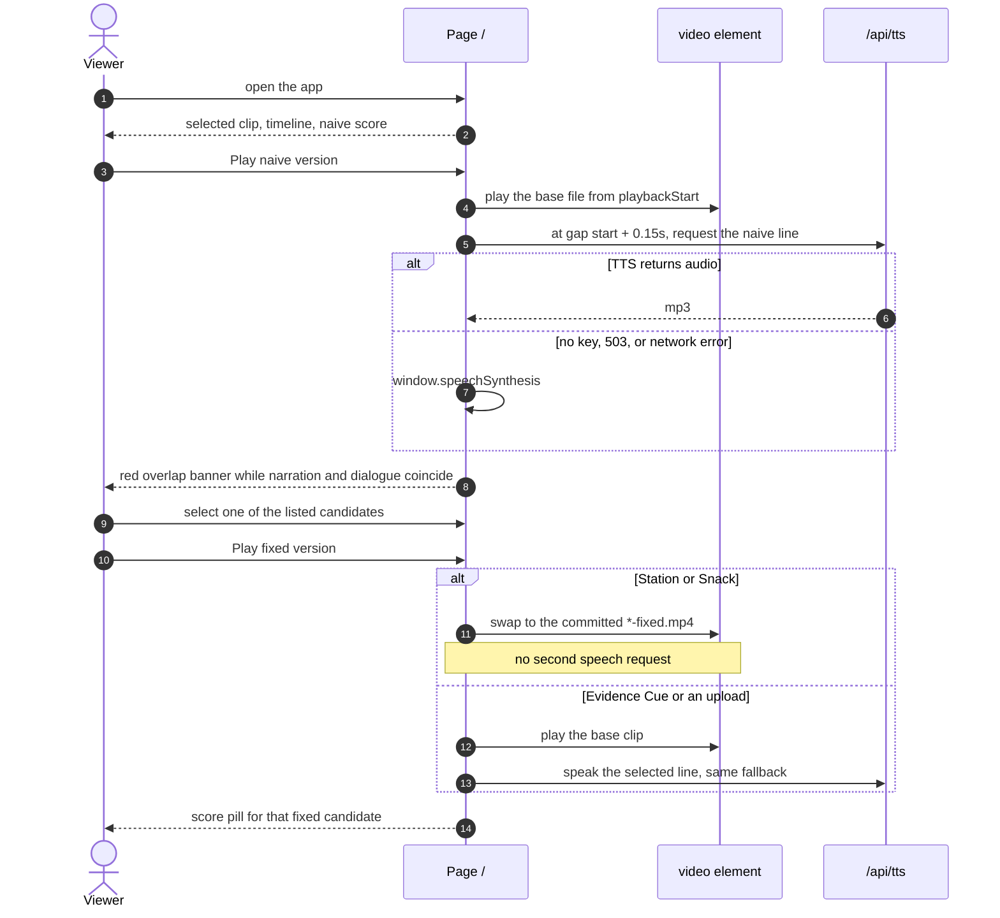

<h1 align="center">GapNarrator</h1>

<p align="center">
  <strong>A correct description still fails if it talks over the next line.</strong><br>
  <sub>Schedules a timed audio-description track into the silent gap, scores the fit, and plays the before and after.</sub>
</p>

<p align="center">
  
  
  
  
  
</p>

---

## ▍The problem

Audio description has to land in the quiet between spoken lines. A line can be accurate and still unusable if it runs into the next sentence.

GapNarrator is a small production console for that timing problem. It shows the gap, a line that is too long, a shorter line, and a score for whether the track fits.

## ▍The pipeline at a glance



| Stage | Where it lives | What it decides |
| --- | --- | --- |
| Gap | `src/lib/timeline.ts` for built-in clips. `detectSilentGaps` in `DemoPlayer.tsx` for uploads. | Built-in gaps are the space between authored dialogue blocks, kept when the gap is at least 0.5s. Uploads use 0.1s RMS windows. A window counts as quiet at `max(0.012, 38th-percentile RMS × 1.45)`. Runs of at least 1.2s are kept, up to six. |
| Naive line | `scheduleNaiveNarration` | Starts 0.15s after the gap. Length is `max(4.2, gap + 1.6)` seconds. That number is assigned. It is not a measured reading. |
| Candidates | `src/data/demoScenario.ts`, or `POST /api/analyze-video` | Built-in clips show the three lines stored on the scenario. Uploads send up to seven 640×360 JPEG frames (quality 0.72) plus the detected gaps. |
| Duration estimate | `estimateSpeechSeconds` | `words / 2.6 + 0.15`. API routes replace the model's own `estimatedSeconds` with this formula. |
| Score | `src/lib/scoring.ts` | Gap fit 35%, no dialogue overlap 35%, coverage 20%, spoiler-safe 10%. Pass is a final score of at least 0.80. Every current caller leaves coverage at 1, so that 20% is always awarded. |
| Voice | `POST /api/tts`, then `speechSynthesis` | The player asks for voice `cedar` on `gpt-4o-mini-tts` (override with `OPENAI_TTS_MODEL`). The route's own default voice, if the request omits one, is `marin`. |
| Compression route | `POST /api/compress-description` | Rewrites one event into three short lines with `OPENAI_MODEL` (default `gpt-5.2`). The homepage never fetches it. |

Upload analysis uses `OPENAI_VIDEO_MODEL`, then `OPENAI_MODEL`, then `gpt-5.2`. With no key, or if the call fails, the route returns generic lines: "The action happens.", "A key detail appears.", "The moment is shown."

## ▍The demo

There are no UI screenshots in this repository. The demo is the app at `/` plus the clips in `public/demo/`.

Three scenarios are hardcoded. Two Snack Attack clips also have a second file with the description already mixed in. Evidence Cue does not.

| Clip | File | Gap | Naive line (scheduled length) | Default short line | Fixed playback |
| --- | --- | --- | --- | --- | --- |
| **Station** | [`snack-station-base.mp4`](public/demo/snack-station-base.mp4) | 5.80–9.20s (3.4s) | "The small traveler rushes across the warm station interior and heads toward the vending area." (5.0s, ends 10.95s) | "She hurries across the station." (2.07s) | [`snack-station-fixed.mp4`](public/demo/snack-station-fixed.mp4) |
| **Snack** | [`snack-machine-base.mp4`](public/demo/snack-machine-base.mp4) | 5.40–9.00s (3.6s) | "The traveler peers through her glasses at the red snack machine while deciding what to buy." (5.2s, ends 10.75s) | "She eyes the snack machine." (2.07s) | [`snack-machine-fixed.mp4`](public/demo/snack-machine-fixed.mp4) |
| **Evidence** | [`demo-evidence-cue.mp4`](public/demo/demo-evidence-cue.mp4) | 6.00–9.00s (3.0s) | "The officer turns back toward the recording equipment and adjusts it to cue the next piece of evidence." (4.6s, ends 10.75s) | "He cues the tape." (1.35s) | Same file. The short line is spoken at playback. |

Default scores from `scoreNarration`, with coverage left at 1:

| Clip | Naive | Fixed, first candidate |
| --- | --- | --- |
| Station | 0.30 fail | 1.00 pass |
| Snack | 0.20 fail | 0.90 pass. Spoiler-safe is 0: the line starts at 5.55s, and the rule wants a start at or after `revealAfter − 0.25` (5.65s). |
| Evidence | 0.30 fail | 1.00 pass |

Station and Snack dialogue labels in the data file are placeholders ("Foreground audio plays…"). They are timing marks, not a transcript. Evidence Cue uses three lines from the episode, including "Keep listening."

The longer source file [`public/raw_vid/Snack_Attack.mp4`](public/raw_vid/Snack_Attack.mp4) is in the repo. The player does not load it. Snack Attack is labeled in code as a user-provided reference clip, with an empty source URL. Evidence Cue is trimmed from the public-domain episode [Dragnet: The Big Phone Call](https://archive.org/details/Dragnet_The_Big_Phone_Call).



On screen, in order:

1. Pick **Station**, **Snack**, or **Evidence**. Uploaded clips appear as **Upload** and are kept three at a time.
2. The timeline draws dialogue, the gap, the reveal, the long red line, and the short green line. A playhead tracks `video.currentTime`.
3. **Play naive version.** The score pill reads FAIL. The overlap banner reads "Overlap: accessibility failure."
4. The candidate list is already filled from the scenario. Click a line to schedule it.
5. **Play fixed version.** Station and Snack play the pre-mixed file. The system message says the video includes the timed track. Evidence Cue and uploads speak the selected line.
6. The pill uses the formula. The sentence under the bar follows the mode. Fixed playback always shows "PASS: narration ends before dialogue returns." Idle and naive playback show the FAIL sentence. `DemoMode` includes `"running"`, and the score panel has copy for it, but the player only sets `idle`, `naive`, and `fixed`.

An upload must be a `video/*` file under 160 MB and under four minutes. Files over 60 MB, or longer than 180 seconds, skip the RMS pass and use a gap placed at 42% of the duration for about 3 seconds. The browser does the frame grab and the loudness pass. The server never receives the video file, only JSON.

If the video file fails to load, the player keeps the timeline and shows "Video asset unavailable."

## ▍Run it

Node and npm. This repo does not pin a Node version.

```sh
npm install
npm run dev
```

Open `http://localhost:3000`.

**No key needed for the three built-in clips.** Candidates, gaps, and the two pre-mixed videos are in the repo. Without `OPENAI_API_KEY`, TTS requests fail and the player uses browser speech synthesis. Upload analysis still returns a scenario, with the generic fallback lines.

```sh
# .env  (names from .env.example; do not commit a real key)
OPENAI_API_KEY=your_openai_api_key_here
OPENAI_MODEL=gpt-5.2
OPENAI_TTS_MODEL=gpt-4o-mini-tts
```

`OPENAI_VIDEO_MODEL` is read by the upload route and is not in `.env.example`. When it is unset, that route uses `OPENAI_MODEL`.

| Route | Limit in one Node process | Body cap | Missing key |
| --- | --- | --- | --- |
| `POST /api/analyze-video` | 8 requests / 60s | 9,000,000 bytes | 200, `source: "fallback"` |
| `POST /api/compress-description` | 20 / 60s | 20,000 bytes | 200, scenario candidates or the first scenario's list |
| `POST /api/tts` | 30 / 60s | 6,000 bytes | 503, then the player speaks in the browser |

Counts live in memory and reset on restart.

```sh
npm run lint
npm run build
npm start
```

`package.json` has `dev`, `build`, `start`, and `lint`. There is no test script.

## ▍Repository map

```
GapNarrator/
├── src/app/page.tsx                         homepage
├── src/app/api/analyze-video/route.ts       upload frames → scenario JSON
├── src/app/api/compress-description/route.ts
├── src/app/api/tts/route.ts
├── src/components/DemoPlayer.tsx            playback, upload, speech
├── src/components/Timeline.tsx
├── src/components/ScorePanel.tsx
├── src/components/NarrationOptions.tsx
├── src/components/BeforeAfterControls.tsx
├── src/data/demoScenario.ts                 the three clips
├── src/lib/timeline.ts · narration.ts · scoring.ts · audioScheduler.ts
├── public/demo/                             base clips and two fixed mixes
├── public/raw_vid/Snack_Attack.mp4          not wired to the player
├── SPEC.md · PRODUCT.md · DESIGN.md
└── skills/gapnarrator-audio-description/    narration rules for agents
```

| Doc | |
| --- | --- |
| [SPEC.md](SPEC.md) | Product spec, score weights, and the intended flow. Its clip list still names Tape Recorder and Phone Recording. Those files are not in `demoScenario.ts`. The table above is the live set. |
| [PRODUCT.md](PRODUCT.md) | Purpose and framing: a timed audio-description track. |
| [DESIGN.md](DESIGN.md) | Light production-utility UI. The page uses that palette. |
| [skills/gapnarrator-audio-description/SKILL.md](skills/gapnarrator-audio-description/SKILL.md) | Rules for lines that have to fit a gap: short, after the reveal, no extra interpretation. |
| [AGENTS.md](AGENTS.md) | Build notes for agents. The shipped page does not follow its dark-console note. |

`ffmpeg-static` and `ffprobe-static` are devDependencies. Nothing under `src/` imports them.

## ▍What this is, and isn't

We'd rather be precise than impressive.

- The output the page asks for is a timed audio-description track. The footer says it is not a caption or a scene summary.
- Built-in gaps, events, and lines are written in `demoScenario.ts`. They are not detected from the pixels at runtime.
- Station and Snack "fixed" playback is a file committed under `public/demo/`. The app does not mix that audio in the browser.
- The naive length is a formula chosen so the line overruns the gap. The short-line lengths are `words / 2.6 + 0.15`, stored on each candidate.
- Coverage is a scoring input, and every caller leaves it at 1.
- The PASS/FAIL pill follows the formula. The sentence under the bar follows the playback mode.
- `POST /api/compress-description` is ready and unused by the UI. There is no "Run GapNarrator" button in the current page. `AGENTS.md` and `SPEC.md` still name that step.
- Upload dialogue strips are placeholders placed on either side of the chosen gap. The browser does not transcribe speech.
- Upload analysis without a key does not describe the frames.
- Rate limits are per server process. There is no account system and no test suite in `package.json`.

## ▍Credits

| | |
| --- | --- |
| App | Next.js 16.2, React 19.2, TypeScript 5, Tailwind CSS 4 |
| UI | Geist via `next/font`, `lucide-react`, `framer-motion` for the playhead |
| API checks | `zod` on the three route bodies |
| Optional models | OpenAI Responses API for compression and upload analysis. OpenAI speech for `cedar` / `marin`. Calls stay on the server. |
| Evidence clip | [Dragnet: The Big Phone Call](https://archive.org/details/Dragnet_The_Big_Phone_Call), public domain, as labeled in `demoScenario.ts` |
| Station and Snack | Snack Attack, labeled in code as a user-provided reference clip |

<p align="center"><sub>The output is a timed audio-description track.</sub></p>
