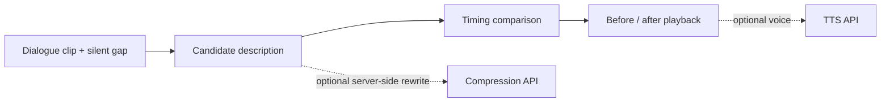

<h1 align="center">GapNarrator</h1>
<p align="center"><b>Timed audio-description production for accessible video.</b></p>

## ▍At a glance



The bundled demo runs without a key, using fixed candidates and browser speech synthesis.

---

Timed audio-description tracks that fit between dialogue.

GapNarrator is a demo webapp for the accessibility production problem that a correct audio description can still fail if it cannot be spoken inside the available silent gap.

## ▍The scheduling pipeline

A visual event needs a description, but that description has to fit the time left between spoken lines. GapNarrator models the timing explicitly: it derives silent gaps from dialogue segments, evaluates candidate narration against a gap, then compares the naïve and fitted schedules.

| Module | Responsibility |
| --- | --- |
| [`src/data/demoScenario.ts`](src/data/demoScenario.ts) | Bundled scenarios, dialogue and event data |
| [`src/lib/timeline.ts`](src/lib/timeline.ts) | Derives silent gaps and finds candidate gaps for an event |
| [`src/lib/narration.ts`](src/lib/narration.ts) | Estimates speech duration, checks fit and chooses candidates |
| [`src/lib/audioScheduler.ts`](src/lib/audioScheduler.ts) | Builds and scores naïve and fitted schedules |
| [`src/lib/scoring.ts`](src/lib/scoring.ts) | Scores narration against the scenario |
| `src/app/api/` | Optional server-side analysis, compression and speech routes |

The speech-duration estimate is an estimate, not a guarantee of actual spoken duration. Listen to the preview and review the timing before treating a track as finished.

---

## Demo

The app now includes three public-domain dialogue clips:

- `The Tape Recorder`: 3.0s gap, fixed line `"He starts the tape."`
- `The Phone Recording`: 3.0s gap, fixed line `"The reel turns."`
- `The Evidence Cue`: 3.0s gap, fixed line `"He cues the tape."`

Each demo shows a long naive line that overlaps dialogue, then a compressed timed audio-description track that fits.

## Video Source

All clips are trimmed from the public-domain Dragnet episode "The Big Phone Call":

```txt
https://archive.org/details/Dragnet_The_Big_Phone_Call
```

Local files:

```txt
public/demo/demo-tape-recorder.mp4
public/demo/demo-phone-recording.mp4
public/demo/demo-evidence-cue.mp4
```

## OpenAI Key

The app does not need an OpenAI key to run the demo.

`OPENAI_API_KEY` enables optional server-side services:

- `/api/compress-description`: live candidate rewriting
- `/api/tts`: less robotic AI voice preview using `marin`

Without a key, GapNarrator uses hardcoded fallback candidates and browser speech synthesis.

## Run

```bash
npm install
npm run dev
```

Open:

```txt
http://localhost:3000
```

## Verification

```bash
npm run lint
npm run build
```
